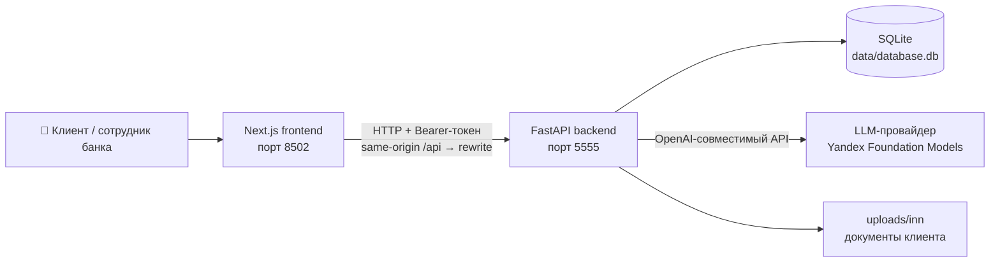
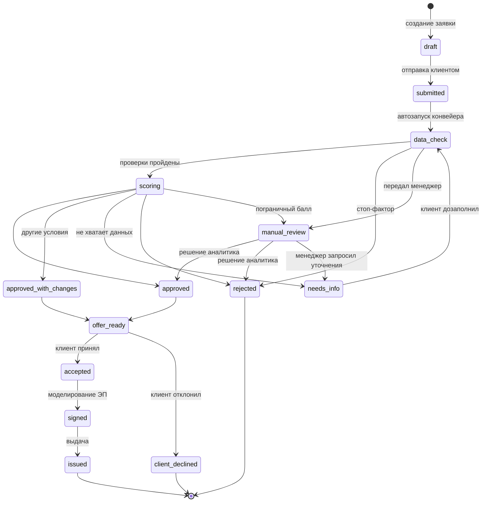

# Цифровой кредитный конвейер для малого и микробизнеса

Прототип единого кредитного процесса: клиентский путь (личный кабинет с ИИ-ассистентом,
подбор продукта, заявка с автозаполнением по ИНН) и внутренняя обработка заявки банка
(проверка данных, скоринг, решение с прозрачной причиной, предложение условий, подписание,
выдача) — в одном связном конвейере.

> Решение подготовлено для хакатона «Цифровой кредитный конвейер» (Альфа-Будущее).
> Версия на момент сдачи: commit `5c1883d` (ветка `dev`).

---

## Содержание

1. [Назначение решения](#назначение-решения)
2. [Ключевые возможности](#ключевые-возможности)
3. [Архитектура](#архитектура)
4. [Стек и сторонние компоненты](#стек-и-сторонние-компоненты)
5. [Требования к окружению](#требования-к-окружению)
6. [Быстрый запуск (Docker)](#быстрый-запуск-docker)
7. [Запуск без Docker (локально)](#запуск-без-docker-локально)
8. [Переменные окружения](#переменные-окружения)
9. [Тестовые учётные записи и данные](#тестовые-учётные-записи-и-данные)
10. [Пошаговый сценарий проверки](#пошаговый-сценарий-проверки)
11. [Статусная модель заявки](#статусная-модель-заявки)
12. [Обзор API](#обзор-api)
13. [Тесты](#тесты)
14. [Допущения и смоделированные интеграции](#допущения-и-смоделированные-интеграции)
15. [Структура репозитория](#структура-репозитория)

## Назначение решения

Малый и микробизнес при оформлении кредита сталкивается с ручным вводом одних и тех же
данных, непонятными решениями банка и отсутствием видимости статуса заявки. Банковская
сторона — с разрозненными этапами обработки и необъяснимыми отказами.

Решение объединяет обе стороны в один процесс:

- **Клиент** описывает задачу бизнеса в диалоге с ИИ-ассистентом → ассистент извлекает
  параметры в профиль, уточняет только недостающее → подбор подходящего продукта →
  заявка с автозаполнением реквизитов по ИНН → прозрачное решение с разбором факторов →
  принятие предложения → подписание → выдача.
- **Банк** получает детерминированный конвейер: проверка данных → скоринг → решение
  (`одобрение / одобрение на других условиях / запрос информации / отказ с причиной`) →
  альтернативные продукты при отказе → единая история статусов заявки.

Принципы (из ТЗ):

- **ИИ решение не принимает** — все решения детерминированы правилами (скоринг,
  стоп-факторы); LLM только ведёт диалог, извлекает данные и объясняет решения.
- **Без ИИ процесс работает полностью** — при недоступности LLM конвейер не блокируется
  (fallback-объяснения из зафиксированных факторов).
- **У каждого итога понятная причина** — любое решение сопровождается `decision_details`
  с факторами, вкладами и текстовым объяснением.
- **Один набор статусов для клиента и банка** — единый словарь статусов и матрица
  разрешённых переходов.

## Ключевые возможности

| Возможность                                                         | Где реализовано                                                                      |
| ------------------------------------------------------------------- | ------------------------------------------------------------------------------------ |
| Авторизация: клиент / кредитный менеджер / кредитный аналитик       | `POST /api/auth/register`, `POST /api/auth/login` (PBKDF2-HMAC-SHA256, Bearer-токен) |
| ИИ-диалог: ассистент уточняет параметры бизнеса                     | `POST /api/conversations/{id}/messages`, LLM-извлечение полей профиля на лету        |
| Подбор продукта по задаче бизнеса                                   | `POST /api/recommendations` — матчинг по цели + доступность по сумме/сроку           |
| Автозаполнение реквизитов по ИНН                                    | `GET /api/registry/{inn}` — мок-реестр (6 компаний с полными профилями)              |
| Заявка: пакет данных клиента + загрузка документов                  | `client_data` в БД, файлы в `uploads/{inn}/`                                         |
| Стоп-факторы: ликвидация компании, текущая просрочка                | шаг `data_check` конвейера — мгновенный `rejected` с объяснением (п. 2.6)            |
| Полный жизненный цикл заявки (14 статусов)                          | `transition_application` + матрица переходов + история статусов                      |
| Детерминированный скоринг (4 фактора)                               | бизнес-возраст, рентабельность, долговая нагрузка, сумма÷выручка                     |
| Решения: одобрение / на других условиях / запрос информации / отказ | `approved` / `approved_with_changes` (обратный аннуитет) / `needs_info` / `rejected` |
| Рабочее место сотрудника банка (менеджер + аналитик)                | `GET /api/admin/applications` + действия: запрос уточнений, передача аналитику, решение с причиной |
| Ручная экспертиза пограничных заявок (балл 50–70)                   | триггер `MANUAL_REVIEW_SCORE_RANGE` → `manual_review` → решение аналитика            |
| Альтернативные продукты при отказе                                  | `src/core/alternatives.py` — подбор ближайшей альтернативы                           |
| ИИ-объяснение решения (для клиента и аналитика)                     | `POST /api/applications/{id}/explain` + fallback без LLM                             |
| Подписание (моделирование ЭП) и выдача                              | `POST .../sign` → `issued`                                                           |
| Единая история заявки                                               | `GET /api/applications/{id}/history` (from/to, actor_type, comment)                  |

## Архитектура



Три контура:

- **Frontend (Next.js, `front/`)** — SPA на Next.js 16 + React 19 (FSD-архитектура,
  Tailwind v4, айдентика Альфа-Банка). Кабинет клиента: диалог с ИИ-ассистентом (markdown,
  оптимистичные сообщения), подбор продуктов с аннуитетным расчётом, анкета «Данные для
  заявки» с автозаполнением по ИНН, отправка заявки в один клик (черновик + конвейер),
  статусы заявок с автообновлением (`GET /api/me/applications`, polling 12 с — решения
  банка видны без действий клиента), действия по статусам (принять/отклонить предложение,
  подписание, альтернативы при отказе), ИИ-объяснение решения, история статусов;
  АРМ сотрудника банка (`/admin`) — очередь всех заявок с фильтром и автообновлением
  (15 с), действия менеджера/аналитика. Браузер ходит только на same-origin `/api/*`,
  который проксируется на backend через `rewrites()` в `next.config.ts` (CORS не нужен).
  Легаси-фронтенд на Streamlit (`frontend/`) сохранён в репозитории как fallback для демо,
  но из docker compose убран.
- **Backend (FastAPI)** — вся бизнес-логика: авторизация, диалоги, профили, рекомендации,
  реестр по ИНН, жизненный цикл заявок, скоринг-конвейер, объяснения. DI через `app.state`,
  SQLAlchemy Core поверх SQLite, миграции применяются идемпотентно при старте.
- **LLM (внешний API)** — OpenAI-совместимый интерфейс (`openai` SDK): ведение диалога,
  извлечение полей профиля, объяснение решений. Провайдер меняется через `.env`
  (`BASE_URL`, ключ, имя модели) — без правок кода. LLM работает вне Docker
  (допустимо по условиям кейса), остальные компоненты — в Docker.

Подробности: `docs/BACKEND_GUIDE.md` (бэкенд), `docs/FRONTEND_GUIDE.md` (фронтенд),
`docs/tz_application_lifecycle.md` (статусная модель), `docs/mvp_implementation_plan.md`
(gap-анализ и план MVP).

## Стек и сторонние компоненты

| Компонент         | Версия                       | Назначение                          |
| ----------------- | ---------------------------- | ----------------------------------- |
| Python            | 3.12                         | язык (зафиксирован в Dockerfile)    |
| FastAPI + Uvicorn | диапазоны `requirements.txt` | REST API, автогенерация OpenAPI     |
| SQLAlchemy (Core) | 2.x                          | работа с SQLite                     |
| Pydantic          | 2.x                          | схемы и валидация                   |
| Next.js           | 16.3.1                       | фронтенд (App Router, прокси /api)  |
| React             | 19.2.8                       | UI (React Compiler)                 |
| Tailwind CSS      | 4.x                          | стили, токены айдентики Альфа-Банка |
| Bun               | 1.3.x                        | пакетный менеджер фронтенда         |
| Streamlit         | ≥1.38                        | легаси-фронтенд (`frontend/`, fallback, вне compose) |
| openai (SDK)      | 1.x–2.x                      | клиент LLM (OpenAI-совместимый API) |
| httpx / requests  | —                            | HTTP-клиенты (тесты / фронтенд)     |
| python-dotenv     | 1.x                          | чтение `.env`                       |
| pytest            | `requirements-dev.txt`       | тесты (229 тестов)                  |

Версии зависимостей зафиксированы диапазонами в `requirements.txt` /
`requirements-dev.txt`; базовый образ backend — `python:3.12-slim`. Зависимости
фронтенда зафиксированы в `front/bun.lock`; сборка — `front/Dockerfile`
(трёхстадийный: `oven/bun:1-slim` → `node:22-slim`).

**Смоделированные интеграции** (синтетические данные, реальных внешних вызовов нет):
мок-реестр юрлиц по ИНН (аналог ЕГРЮЛ/ЕГРИП), подписание без реальной ЭП. Полный список
допущений — в разделе [Допущения](#допущения-и-смоделированные-интеграции).

## Требования к окружению

- **Docker Engine** + **docker compose plugin** (основной способ запуска), **или**
- Python 3.12+ и pip — для локального запуска без Docker;
- API-ключ любого OpenAI-совместимого LLM-провайдера (например, Yandex Foundation Models);
- ~2 ГБ свободной памяти; ОС: Linux / macOS / Windows.

## Быстрый запуск (Docker)

```bash
# 1. Клонировать репозиторий
git clone <url-репозитория> credit-profile && cd credit-profile

# 2. Создать .env в корне (см. таблицу переменных ниже)
cat > .env <<'EOF'
BASE_URL=https://llm.api.cloud.yandex.net/v1
YANDEX_API_KEY=<ваш-api-ключ>
YANDEX_FOLDER=<folder-id>
MODEL_NAME=<имя-модели>
TEMPERATURE=0.0
MAX_OUTPUT_TOKENS=2500
EOF

# 3. Поднять стек
docker compose up -d --build

# 4. Проверить здоровье
curl http://localhost:5555/health        # {"status": "ok"}
```

- Фронтенд: **http://localhost:8502**
- Backend API: **http://localhost:5555** (интерактивный Swagger UI отключён,
  справочник контрактов — `docs/FRONTEND_GUIDE.md`)
- БД и логи проброшены на хост: `./data/` (SQLite, `data/logs/backend.log`)

Порты меняются переменными `BACKEND_PORT` / `FRONTEND_PORT` (дефолты 5555 / 8502).

## Запуск без Docker (локально)

```bash
python -m venv venv
venv\Scripts\activate            # Windows; source venv/bin/activate — Linux/macOS
pip install -r requirements.txt

# .env — как выше, в корне проекта

python main.py                   # backend на http://localhost:5555
# во втором терминале — фронтенд (нужен Bun: https://bun.sh):
cd front && bun install
bun run dev                      # frontend на http://localhost:8502
```

По умолчанию dev-сервер фронтенда проксирует `/api/*` на `http://127.0.0.1:5555`;
другой адрес backend задаётся переменной `BACKEND_URL` (учитывается при сборке —
`next build`, и в dev-режиме). Легаси-фронтенд Streamlit запускается как раньше:
`streamlit run frontend/app.py` (порт 8501).

## Переменные окружения

| Переменная                       | Обязательна | Назначение                                                   | По умолчанию                 |
| -------------------------------- | ----------- | ------------------------------------------------------------ | ---------------------------- |
| `BASE_URL`                       | да          | URL OpenAI-совместимого API провайдера LLM                   | —                            |
| `YANDEX_API_KEY`                 | да          | API-ключ провайдера LLM (в логи не пишется)                  | —                            |
| `YANDEX_FOLDER`                  | нет         | folder_id каталога Yandex Cloud                              | —                            |
| `MODEL_NAME`                     | да          | Имя модели (логируется вместо полного URI)                   | —                            |
| `TEMPERATURE`                    | нет         | Температура генерации (float)                                | `0.0`                        |
| `MAX_OUTPUT_TOKENS`              | нет         | Лимит токенов ответа (int)                                   | `2500`                       |
| `REASONING_EFFORT`               | нет         | Усилие рассуждения модели                                    | `low`                        |
| `DEMO_MODE`                      | нет         | Демо-режим легаси-фронтенда Streamlit                        | `false`                      |
| `DATABASE_URI`                   | нет         | Строка подключения к БД                                      | `sqlite:///data/database.db` |
| `BACKEND_PORT` / `FRONTEND_PORT` | нет         | Порты хоста в docker compose                                 | `5555` / `8502`              |
| `BACKEND_URL`                    | нет         | Цель прокси `/api/*` фронтенда (build-arg `front/Dockerfile`) | `http://backend:5555`        |
| `LOG_DIR`                        | нет         | Каталог файловых логов backend                               | `data/logs`                  |

## Тестовые учётные записи и данные

Учётные записи **не предзасеяны** — создайте свои за 10 секунд на странице входа
(вкладка «Регистрация», выбор роли) или через API. Для демо удобны три учётки:

| Роль           | Логин (пример) | Пароль (пример) | Интерфейс                       |
| -------------- | -------------- | --------------- | ------------------------------- |
| `client`       | `demo_client`  | `demo1234`      | кабинет клиента `/`             |
| `bank_manager` | `demo_manager` | `demo1234`      | АРМ `/admin`                    |
| `bank_analyst` | `demo_analyst` | `demo1234`      | АРМ `/admin` (решения аналитика) |

```bash
curl -X POST http://localhost:5555/api/auth/register \
  -H "Content-Type: application/json" \
  -d '{"username": "demo_client", "password": "demo1234", "role": "client"}'
```

Роли: `client` (по умолчанию), `bank_manager`, `bank_analyst`.

**Синтетический реестр компаний по ИНН** (мок ЕГРЮЛ/ЕГРИП, `GET /api/registry/{inn}`) —
используйте любой ИНН на шаге заявки для автозаполнения:

| ИНН            | Компания                    | Финансы (год)                             | Что демонстрирует                                       |
| -------------- | --------------------------- | ----------------------------------------- | ------------------------------------------------------- |
| `7701234567`   | ООО «Северная пекарня»      | выручка 48 млн, прибыль 6 млн (≈12,5%)    | сильный профиль → одобрение                             |
| `7812345678`   | ООО «Городская логистика»   | выручка 120 млн, прибыль 15 млн (≈12,5%)  | крупный устойчивый бизнес                               |
| `5024123456`   | ООО «ЭкоПласт»              | выручка 75 млн, прибыль 9,5 млн (≈12,7%)  | длинная история (с 2009 г.)                             |
| `6150123456`   | ООО «Ремстрой-Юг»           | выручка 60 млн, прибыль 4,2 млн (≈7%)     | низкая рентабельность → вероятен отказ с альтернативами |
| `502712345678` | ИП Петров Алексей Сергеевич | выручка 9,6 млн, прибыль 1,4 млн (≈14,6%) | ИП, малый масштаб                                       |
| `7703456789`   | ООО «Вектор-Строй»          | выручка 31 млн, прибыль 2,4 млн (≈7,7%)   | компания в ликвидации → мгновенный отказ (стоп-фактор)  |

Каталог продуктов (4 позиции): «Оборотный капитал», «Бизнес-рост», «Оборудование»,
«Экспресс для бизнеса» — `GET /api/products`.

## Пошаговый сценарий проверки

Пять приёмочных сценариев проходятся в UI (http://localhost:8502) на синтетических
данных. Для сценария 4 нужны ещё две учётки: `demo_manager` (менеджер) и
`demo_analyst` (аналитик) — регистрация через UI или API (см. таблицу выше).

1. **Быстрое автоодобрение.** Войдите клиентом → в чате опишите бизнес
   (_«Пекарня, 6 лет на рынке, выручка 4 млн в месяц, прибыль 500 тысяч, нужно
   3 млн на 12 месяцев на закупку сырья»_) → во вкладке «Продукты» появится подбор →
   «Выбрать» → параметры и расчёт платежа → «Оформить заявку» → в анкете введите
   ИНН `7701234567` → «Заполнить по ИНН» → документы (любые файлы) + оба согласия →
   «Отправить заявку». Статус дойдёт до **«Предложение готово»** → «Принять условия» →
   «Подписать договор» → **«Выдана»** ✅.
2. **Дозагрузка документа.** Заявка с неполными данными (например, менеджер запросил
   уточнения через АРМ или скоринг вернул `needs_info`) → клиент видит причину
   во вкладке «Заявки», дозаполняет профиль в диалоге → «Обработать повторно» →
   одобрение.
3. **Альтернативные условия.** Запросите сумму выше возможной для профиля
   (например, ИНН `7812345678`, запрос 10 млн при текущих показателях) → статус
   **«Предложение готово»** с пометкой «Одобрена с изменениями» — карточка покажет
   скорректированные условия (было → стало) → «Принять условия».
4. **Ручная экспертиза.** Пограничный профиль (стаж ~1,5 года, маржа ~12%,
   нагрузка ~25% — например, ИНН `5024123456` с запросом, близким к порогу) → статус
   **«Ручная экспертиза»**. Войдите менеджером (`/admin`): очередь → заявка →
   «Запросить уточнения» (клиент видит текст у себя) или сразу передайте аналитику.
   Войдите аналитиком: очередь → заявка → решение с причиной → клиент видит
   результат и может запросить «Объяснить решение (ИИ)».
5. **Отказ с причиной.** Заявка с отметкой «есть долги по налогам и зарплате»
   (например, ИНН `6150123456` с долгами в анкете) → **«Отказ»** до скоринга:
   причина стоп-фактора понятным языком + альтернативные продукты с кнопкой
   «Оформить заявку» (создаётся новый черновик).

Сквозные проверки: сессия переживает перезагрузку страницы (токен в localStorage +
`GET /api/auth/me` при старте); решение аналитика появляется у клиента без перезахода
(polling «Заявок», 12 с); невалидный токен → автоматический разлогин и редирект на
вход; действие не своей роли в АРМ → понятное сообщение о 403.

Быстрая проверка API без UI: справочник контрактов — `docs/FRONTEND_GUIDE.md`
(Swagger UI на backend отключён).

## Статусная модель заявки



Единый словарь статусов и матрица переходов: `src/schemas/application_schema.py`
(`APPLICATION_STATUSES`, `ALLOWED_TRANSITIONS`); смена статуса — только через
`transition_application` с записью в `application_status_history`.

## Обзор API

Полная спецификация — http://localhost:5555/docs (OpenAPI генерируется автоматически).

| Метод и путь                                                                  | Назначение                                  |
| ----------------------------------------------------------------------------- | ------------------------------------------- |
| `GET /health`                                                                 | health-check                                |
| `POST /api/auth/register` / `login`, `GET /api/auth/me`                       | регистрация, вход, текущий пользователь     |
| `POST /api/conversations`, `POST /api/conversations/{id}/messages`, `GET ...` | диалоги с ассистентом                       |
| `POST /api/recommendations`                                                   | подбор продуктов по профилю                 |
| `POST /api/profile`, `PATCH/GET /api/profile/{id}`                            | профиль бизнеса                             |
| `POST /api/profile/{id}/payment`                                              | расчёт аннуитетного платежа                 |
| `GET /api/registry/{inn}`                                                     | мок-реестр компаний по ИНН                  |
| `GET /api/products`                                                           | каталог продуктов                           |
| `POST /api/applications`                                                      | создание заявки (черновик, с `client_data`) |
| `PATCH /api/applications/{id}`                                                | правка черновика (сумма/срок)               |
| `POST /api/applications/{id}/submit`                                          | отправка заявки                             |
| `POST /api/applications/{id}/scoring`                                         | запуск скоринг-конвейера                    |
| `POST /api/applications/{id}/offer-response`                                  | принять/отклонить предложение               |
| `POST /api/applications/{id}/sign`                                            | моделирование подписания                    |
| `POST /api/applications/{id}/explain`                                         | ИИ-объяснение решения (client/analyst)      |
| `GET /api/applications/{id}/history`                                          | история статусов                            |
| `GET /api/profile/{id}/applications`                                          | заявки профиля                              |

Все клиентские ручки требуют Bearer-токен; чужие объекты → 404.

## Тесты

```bash
pip install -r requirements-dev.txt
pytest                # 229 тестов, все зелёные
```

Покрытие: авторизация и изоляция пользователей, полный жизненный цикл статусов,
скоринг-конвейер (включая триггер manual_review), альтернативные продукты, реестр,
LLM-пайплайны (на моках), логирование. CI: `.github/workflows/deploy.yaml`
(pytest → деплой).

## Допущения и смоделированные интеграции

| Допущение                        | Как смоделировано                                                                                                       |
| -------------------------------- | ----------------------------------------------------------------------------------------------------------------------- |
| Реестр юрлиц (ЕГРЮЛ/ЕГРИП)       | Мок на синтетических данных: `src/config/registry.py`, 5 компаний с полными профилями (компания, руководитель, финансы) |
| Кредитные бюро, налоговые данные | Не интегрируются (по условиям кейса); шаг `data_check` в конвейере — структурная заглушка с мгновенным проходом         |
| Подписание (ЭП/ЭДО)              | Моделируется кнопкой «Подписать» (`POST .../sign`), реальная ЭП не реализована                                          |
| Данные                           | Полностью синтетические; БД SQLite создаётся автоматически при первом старте                                            |
| LLM                              | Внешний OpenAI-совместимый API вне Docker; при недоступности — детерминированный fallback, процесс не блокируется       |
| Конфиденциальность               | В LLM уходят только данные диалога и `decision_details`; API-ключ и folder_id не логируются                             |

## Структура репозитория

```
main.py                    # FastAPI: эндпоинты, lifespan (миграции, DI)
front/                     # Next.js 16 фронтенд (FSD): кабинет клиента + АРМ
  src/app/                 # роутинг (route groups: auth/client/bank)
  src/fsd/                 # app/pages/widgets/features/entities/shared
  Dockerfile               # трёхстадийная сборка (bun → node build → runner)
frontend/app.py            # легаси Streamlit-фронтенд (fallback, вне compose)
src/
  config/                  # каталог продуктов, реестр ИНН, скоринг, промпты, SQL
  core/                    # репозитории, скоринг, альтернативы, жизненный цикл, auth
  core/llm/                # LLM-клиент, извлечение профиля, объяснения, tools
  database/                # коннектор SQLite, идемпотентные миграции
  schemas/                 # Pydantic-схемы (статусы, заявки, профили, auth)
tests/                     # pytest: 229 тестов
docs/                      # гайды, ТЗ статусной модели, план MVP, Q&A кейса
docker-compose.yaml        # backend + frontend (Next.js), healthcheck, volumes
Dockerfile, front/Dockerfile
```

---

**Контакты команды:** (заполнить перед сдачей)
